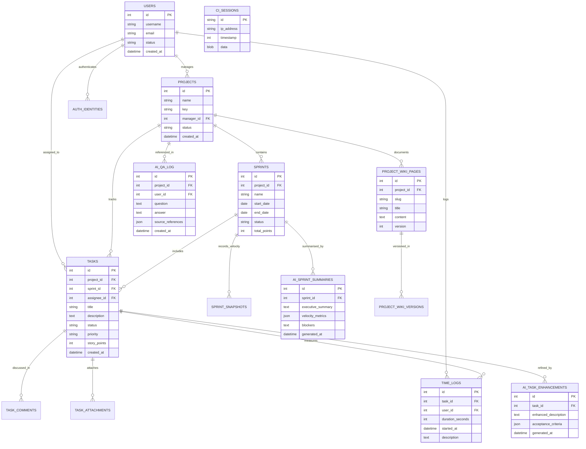

# Data & Storage Architecture

This document specifies data persistence, relational schemas, in-memory caching strategies, and file storage for the unified platform.

---

## 🗄 Relational Storage: MySQL 8.4

The central relational database is named `db_chege_jira` and managed by MySQL 8.4 LTS.

### 1. Volume Persistence
Data is preserved inside the named Docker volume `mysql-data`:
- **Container Path:** `/var/lib/mysql`
- **Engine:** InnoDB with `utf8mb4_unicode_ci` collation
- **SQL Mode:** Strict transactional tables (`STRICT_TRANS_TABLES,NO_ZERO_IN_DATE...`)

---

## 📊 Entity-Relationship Diagram (ERD)

The diagram below reflects the relational database schema defined by the 33 versioned migrations in `services/web/app/Database/Migrations/`:

---

## ⚡ In-Memory Storage: Redis 7

Redis handles high-throughput volatile operations and asynchronous coordination:

1. **User Sessions:**
   - Keys: `chege_jira_session*` / `ci_session*`
   - Primary driver for CodeIgniter 4. Falls back to MySQL `ci_sessions` table if Redis is temporarily offline.
2. **ML Background Tasks:**
   - Keys: `task:<uuid>` (TTL: 86,400s)
   - Stores task payload, status (`pending`, `processing`, `completed`, `failed`), progress percentage, and output text.
3. **Application Cache:**
   - Application telemetry vitals, active model catalog, and pre-computed dashboard metrics.
4. **Volume Persistence:**
   - Bound to `redis-data:/data` with Append-Only File (`AOF`) logging enabled (`--appendonly yes`).

---

## 🪣 Object Storage: MinIO S3-Compatible Storage

All unstructured binary assets (attachments, avatars, and database dumps) are managed through MinIO S3 object storage.

### 1. Bucket Topology & Lifecycles

| Bucket Name | Purpose | Access Control | Storage Format | Delivery Mode |
| :--- | :--- | :--- | :--- | :--- |
| **`agile-attachments`** | Task attachments, specs, QA logs | Private (RBAC-guarded) | `tasks/{task_id}/{hash}.{ext}` | Pre-signed URL or stream proxy |
| **`agile-avatars`** | User profile photos | Public read or pre-signed | `avatars/{user_id}.{ext}` | Pre-signed URL or stream proxy |
| **`agile-backups`** | Automated database snapshots | Private (Admin only) | `backups/db_backup_{timestamp}.sql.gz` | Admin stream download |

### 2. Dual Delivery Mechanism

The platform supports two delivery modes configured via `S3_DIRECT_PRESIGNED`:
1. **Direct Pre-signed URL (Default / High Performance):**
   - The WebApp generates an AWS Signature v4 pre-signed URL with a 1-hour expiration.
   - When a user downloads a file, the controller returns an HTTP 307 redirect directly to MinIO.
   - Offloads multi-megabyte I/O streaming from PHP worker processes.
2. **Streaming Proxy Mode (Private / Air-Gapped Networks):**
   - When MinIO is not directly addressable by the client browser, the WebApp acts as a streaming proxy, pulling the S3 object over the internal Docker network and streaming bytes to the client.

### 3. Volume Persistence & Cloud Portability
- **Persistence:** MinIO data is persisted inside Docker named volume `minio-data` (`/data`).
- **Cloud Migration:** By updating `.env` parameters (`S3_ENDPOINT`, `S3_ACCESS_KEY`, `S3_SECRET_KEY`), the entire storage layer can seamlessly point to AWS S3, Google Cloud Storage, or Cloudflare R2 without code changes.

---

## 📁 File System & Local Volumes

1. **GGUF Models Directory (Local POSIX Volume):**
   - Path: `services/ml/models/` mounted to `/app/models:rw`.
   - `llama-cpp-python` relies on memory-mapped files (`mmap()`) for ultra-low latency inference; therefore GGUF model weights remain on the local POSIX filesystem rather than object storage.
2. **Local Uploads & Fallback Cache:**
   - Path: `services/web/writable/uploads/`
   - Serves as the temporary staging area before S3 uploads, and provides backward-compatible fallback for legacy files.
   - Existing legacy files can be migrated to MinIO at any time via `php spark storage:migrate-to-s3`.
3. **Database Backup Staging:**
   - Path: `services/web/writable/backups/`
   - Staging area where `mysqldump` generates `.sql.gz` archives prior to mirroring into the `agile-backups` S3 bucket.
